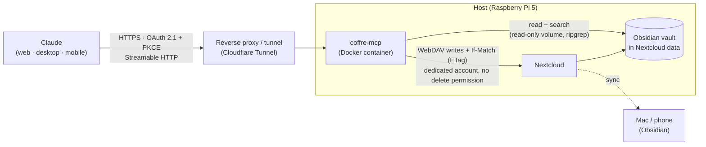

# Vault MCP — giving Claude safe access to a self-hosted Obsidian vault

[](https://github.com/Romain-Data/obsidian-vault-mcp/actions/workflows/tests.yml)


[](LICENSE)

[🇫🇷 Français](README.md) · 🇬🇧 English

A **remote MCP server** (Model Context Protocol) written in Python that lets Claude (web, desktop, mobile) **read, search and edit** my Obsidian notes stored in a self-hosted Nextcloud — **with no way to delete anything**, and only after an **OAuth 2.1 + passphrase + TOTP** login.

In production since November 2026 on a Raspberry Pi 5, behind a Cloudflare Tunnel. It is now the main interface to my vault: Claude writes in it more than I do.

> The code, comments and tool descriptions are in French (the vault is in French). This README is the English entry point.

## The problem

- My Obsidian vault lives in my Nextcloud. Claude could only reach it from the Mac desktop app, with the folder attached to the conversation. From my phone: nothing.
- There was no official Nextcloud / WebDAV / Obsidian connector for claude.ai.
- The notes are very personal and the access is **read-write**: it needs real authentication, no possibility of deletion, and a history of every change.

## Architecture



| Module | Role |
| --- | --- |
| `server.py` | MCP server (official SDK `MCPServer`): 6 tools, OAuth *resource server* (token checked on every request, audience enforced) |
| `auth.py` | Minimal **OAuth 2.1 authorization server**: 1 user, 1 pre-registered client, PKCE S256, passphrase (scrypt) + TOTP, tokens stored as hashes only |
| `coffre.py` | Vault access: path validation, local read/search, writes with conflict resolution |
| `webdav.py` | WebDAV client for Nextcloud, with ETag checks (`If-Match`) |
| `init_secrets.py` | Generates the secrets into `.env` (hashed passphrase, TOTP QR code, client secret) |

### Tools exposed to Claude

| Tool | Effect |
| --- | --- |
| `lister` (list) | Lists files (hidden folders excluded) |
| `lire_note` (read) | Reads a note |
| `chercher` (search) | Full-text search (ripgrep), at most 5 hits per note |
| `ecrire_note` (write) | Creates a `.md` note; refuses to overwrite unless explicitly asked |
| `ajouter_a_note` (append) | Appends to a note |
| `remplacer_dans_note` (replace) | Replaces a passage that must be **unique** in the note |

No delete or rename tool. Read tools are annotated `readOnlyHint`, write tools `destructiveHint=false`.

## Security choices, and why

| Choice | Why |
| --- | --- |
| **Local reads, WebDAV writes** | Reading the mounted folder is fast (ripgrep). But writing straight to disk would bypass Nextcloud: no version, stale cache, devices not notified. Going through WebDAV, Nextcloud **keeps a version of every change** and syncs devices. |
| **"No deletion" enforced by Nextcloud, not by my code** | Writes use a dedicated account that the folder is shared with **without delete or reshare permission**. Even a bug or a prompt injection forging a `DELETE` gets a 403 (verified in production). Defence in depth. |
| **ETag checks (`If-Match`)** | If the note changed between read and write (sync from the phone…), Nextcloud refuses (412). The server re-reads and re-applies the edit, up to 3 times: a change made elsewhere is **never overwritten**. |
| **Minimal in-house OAuth server**, pre-registered client | claude.ai requires OAuth for a remote connector. The SDK's built-in authorization server is discouraged for new code, and an external provider (Auth0…) meant adding a third party for a single user. No dynamic client registration: nobody else can register. |
| **Passphrase (scrypt) + non-replayable TOTP** | Two factors. The passphrase is stored nowhere (only its scrypt hash); a TOTP code already used is rejected. 5 failures in 15 min → lockout; 1 s delay per failure. |
| **Tokens**: access 1 h, refresh 30 days **rotated on every use** | A reused refresh token signals theft: **the whole token family is revoked**. Only SHA-256 hashes are stored: a database leak yields no usable token. |
| **Hardened `/authorize`** | Client and redirect URI checked **before** any redirect (no open redirect), PKCE S256 required, `resource` (RFC 8707) and `scope` checked, single-use request id, strict CSP, no framing. |
| **DNS rebinding protection** | Allowed host = the public URL, allowed origin = `https://claude.ai`. |
| **Paths** | Rejected: absolute paths, `..`, null bytes, hidden files and folders (including `.obsidian/`), symlinks escaping the vault. Writes limited to `.md`, size capped. |
| **Container** | Non-root user, read-only filesystem, all Linux capabilities dropped, `no-new-privileges`, vault mounted read-only. |
| **Exposure** | No port open on the home router: Cloudflare Tunnel, TLS at Cloudflare. |

## Installation

Requirements: Docker, a Nextcloud (tested with Nextcloud AIO), a public HTTPS URL reaching the container (Cloudflare Tunnel, Caddy, Traefik…), a Claude plan that allows custom connectors.

1. **Nextcloud**: create a dedicated account (e.g. `claude-mcp`), share the vault folder with it with **Read, Edit, Create** permissions (untick Delete and Reshare), then create an app password for it:
   ```bash
   docker exec -it -u www-data nextcloud-aio-nextcloud php occ user:auth-tokens:add claude-mcp
   ```
2. **Configuration**:
   ```bash
   cp -n .env.example .env && chmod 600 .env && mkdir -p data
   # fill in PUBLIC_URL, COFFRE_HOTE, NEXTCLOUD_*, NEXTCLOUD_APP_PASSWORD
   docker compose build
   docker compose run --rm -it -v ./.env:/app/.env coffre-mcp python -m coffre_mcp.init_secrets /app/.env
   docker compose up -d && docker logs --tail 20 coffre-mcp
   ```
   `init_secrets` asks for a passphrase, shows a TOTP QR code to scan, then prints the *Client ID* and *Client Secret*.
3. **Exposure**: route the public URL to `coffre-mcp:8000` (plain HTTP internally). Check: `curl https://<url>/sante` → `ok`; `curl -i https://<url>/mcp` → `401` with `WWW-Authenticate: Bearer resource_metadata=…`.
4. **claude.ai**: Settings → Connectors → *Add custom connector* → URL `https://<url>/mcp`, then *Use your own OAuth client* with the id and secret. Login: passphrase + TOTP code.

Recommended: an `_index.md` file at the vault root (one line per note) and a `_Conventions.md`; the tool descriptions tell Claude to start there.

### Development

```bash
uv sync
uv run pytest        # 34 tests: full OAuth flow, paths, ETag, conflicts, search
```

## Bugs found in production (and fixed)

- **"-gzip" ETag → intermittent 412s.** Small notes could be edited, `_index.md` could not. Apache (`mod_deflate`) compressed responses of a few KB and **appended `-gzip` to the ETag**; sent back in `If-Match`, Nextcloud no longer recognised it. Fix: read with `Accept-Encoding: identity`, prefer `OC-ETag`, strip the suffix defensively. Regression test in `tests/test_webdav.py`.
- **Orphaned lock → 423 Locked.** Nextcloud's web editor had left a lock with no expiry on a note, with no editing session open. Neither the server nor the Mac sync client could write. Diagnosed in the database (`oc_files_lock`, no `occ` command for it), lock removed surgically. Prevention: don't open vault notes in the web editor.
- **Claude didn't know what the connector was for.** Some clients (Claude Code with deferred tools) pass on neither the server instructions nor its name. Every tool now carries a self-contained description (what the vault holds, where to start), configurable through `COFFRE_DESCRIPTION`.

## Known limitations

- **Single user, single client** (claude.ai). No dynamic client registration (DCR) or CIMD.
- **Global lockout** after 5 failures: it stops brute force, but anyone who knows the URL can lock me out for 15 min. The state is in memory (reset on restart). Next step: per-IP limits, or a WAF rule restricting `/mcp` to Anthropic's IP ranges.
- **Same host as Nextcloud**: reads use the mounted folder.
- **Full-text search only** (case-insensitive substring): no semantic search.
- **Stateless transport, JSON responses** (no SSE stream): no server → client notifications.
- Code, messages and tool descriptions **in French**.
- Tested with claude.ai (web, desktop, mobile) and Claude Code; not with other MCP clients.

## License

[MIT](LICENSE)
