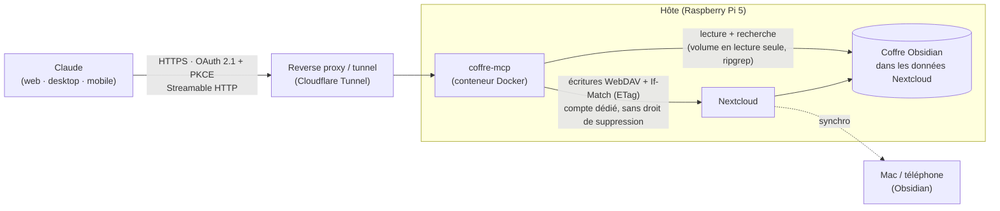

# Coffre MCP — donner à Claude un accès sûr à un coffre Obsidian auto-hébergé

[](https://github.com/Romain-Data/obsidian-vault-mcp/actions/workflows/tests.yml)


[](LICENSE)

🇫🇷 Français · [🇬🇧 English](README.en.md)

Serveur **MCP distant** (Model Context Protocol) écrit en Python, qui permet à Claude (web, desktop, mobile) de **lire, chercher et modifier** mes notes Obsidian stockées dans un Nextcloud auto-hébergé — **sans jamais pouvoir supprimer**, et seulement après une connexion **OAuth 2.1 + phrase de passe + code TOTP**.

En service depuis novembre 2026 sur un Raspberry Pi 5, derrière un Cloudflare Tunnel. C'est aujourd'hui l'interface principale de mon coffre : Claude y écrit plus que moi.

## Le problème

- Mon coffre Obsidian vit sur mon Nextcloud. Claude n'y avait accès que depuis l'app desktop du Mac, avec le dossier ouvert dans la conversation. Depuis le téléphone : rien.
- Aucun connecteur officiel Nextcloud / WebDAV / Obsidian n'existait pour claude.ai.
- Les notes sont très personnelles et l'accès est **en écriture** : il faut une vraie authentification, aucune possibilité de suppression, et un historique de chaque modification.

## Architecture



| Brique | Rôle |
| --- | --- |
| `server.py` | Serveur MCP (`MCPServer` du SDK officiel) : 6 outils (+ 4 pour l'agenda), *resource server* OAuth (jeton vérifié à chaque requête, audience contrôlée) |
| `auth.py` | Mini **serveur d'autorisation OAuth 2.1** : 1 utilisateur, 1 client pré-enregistré, PKCE S256, phrase de passe (scrypt) + TOTP, jetons stockés sous forme d'empreintes |
| `coffre.py` | Accès au coffre : validation des chemins, lecture/recherche locales, écritures avec résolution de conflit |
| `webdav.py` | Client WebDAV vers Nextcloud, avec contrôle d'ETag (`If-Match`) |
| `agenda.py` | Client CalDAV (optionnel) : agendas, événements, récurrences, conflits par ETag |
| `init_secrets.py` | Génère les secrets dans le `.env` (phrase de passe hachée, QR code TOTP, secret client) |

### Outils exposés à Claude

| Outil | Effet |
| --- | --- |
| `lister(dossier, recursif)` | Liste les fichiers (dossiers cachés exclus) |
| `lire_note(chemin)` | Lit une note |
| `chercher(requete, dossier, max_resultats)` | Recherche plein texte (ripgrep), 5 résultats max par note |
| `ecrire_note(chemin, contenu, remplacer_si_existe)` | Crée une note `.md` ; refuse d'écraser sauf demande explicite |
| `ajouter_a_note(chemin, texte)` | Ajoute à la fin d'une note |
| `remplacer_dans_note(chemin, ancien, nouveau)` | Remplace un passage qui doit être **unique** dans la note |

**Agenda (optionnel, `AGENDA_ACTIF=1`)** — par CalDAV, avec le même compte Nextcloud :

| Outil | Effet |
| --- | --- |
| `lister_agendas()` | Agendas visibles, droits, agenda par défaut |
| `lister_evenements(debut, fin, agenda_nom)` | Événements d'une période, récurrences développées, avec leur id |
| `creer_evenement(titre, debut, fin, journee_entiere, lieu, description, rappel_minutes, recurrence, agenda_nom)` | Crée un événement (heure locale, rappel, règle RRULE) |
| `modifier_evenement(id_evenement, …)` | Ne change que les champs fournis ; déplacer le début garde la durée |

Les événements arrivent sur le téléphone par DAVx⁵ (ou tout client CalDAV) : Claude peut ainsi gérer l'agenda depuis n'importe quel appareil.

Aucun outil de suppression ni de renommage. Pour les notes, c'est garanti par Nextcloud (voir plus bas) ; pour l'agenda, seulement par le code, car un partage d'agenda en écriture autorise aussi la suppression (la corbeille de Nextcloud Agenda reste le filet). Les outils de lecture sont annotés `readOnlyHint`, ceux d'écriture `destructiveHint=false`.

## Choix de sécurité, et pourquoi

| Choix | Pourquoi |
| --- | --- |
| **Lecture locale, écriture par WebDAV** | Lire le dossier monté est rapide (ripgrep). Mais écrire directement sur le disque contournerait Nextcloud : pas de version, cache périmé, appareils non prévenus. En passant par WebDAV, Nextcloud **garde une version de chaque modification** et synchronise les appareils. |
| **« Pas de suppression » garanti par Nextcloud, pas par le code** | Les écritures passent par un compte dédié à qui le dossier est partagé **sans droit de suppression ni de repartage**. Même un bug ou une injection de prompt qui forgerait un `DELETE` reçoit un 403 (vérifié en production). Défense en profondeur. |
| **Contrôle d'ETag (`If-Match`)** | Si la note a changé entre la lecture et l'écriture (synchro depuis le téléphone…), Nextcloud refuse (412). Le serveur relit et réapplique la modification, 3 fois maximum : un changement fait ailleurs n'est **jamais écrasé**. |
| **Serveur OAuth maison minimal**, client pré-enregistré | claude.ai exige OAuth pour un connecteur distant. Le serveur d'autorisation intégré au SDK est déconseillé pour du neuf, et un fournisseur externe (Auth0…) ajoutait un tiers pour un seul utilisateur. Pas d'enregistrement dynamique de clients : personne d'autre ne peut se déclarer. |
| **Phrase de passe (scrypt) + TOTP non rejouable** | Deux facteurs. La phrase n'est stockée nulle part (seulement son empreinte scrypt) ; un code TOTP déjà utilisé est refusé. 5 échecs en 15 min → verrouillage ; 1 s de délai par échec. |
| **Jetons** : accès 1 h, renouvellement 30 j **changé à chaque usage** | Un jeton de renouvellement réutilisé signale un vol : **toute la famille de jetons est révoquée**. Seules les empreintes SHA-256 sont en base : une fuite de la base ne donne aucun jeton utilisable. |
| **`/authorize` durci** | Client et adresse de retour vérifiés **avant** toute redirection (pas de redirection ouverte), PKCE S256 obligatoire, `resource` (RFC 8707) et `scope` contrôlés, identifiant de demande à usage unique, CSP stricte, pas d'iframe. |
| **Protection DNS rebinding** | Hôte autorisé = l'URL publique, origine autorisée = `https://claude.ai`. |
| **Chemins** | Refusés : chemins absolus, `..`, octets nuls, fichiers et dossiers cachés (dont `.obsidian/`), liens symboliques qui sortent du coffre. Écriture limitée aux `.md`, taille plafonnée. |
| **Conteneur** | Utilisateur non root, système de fichiers en lecture seule, aucune capacité Linux, `no-new-privileges`, coffre monté en lecture seule. |
| **Exposition** | Aucun port ouvert sur la box : Cloudflare Tunnel, TLS chez Cloudflare. |

## Installation

Prérequis : Docker, un Nextcloud (testé avec Nextcloud AIO), une URL publique en HTTPS qui atteint le conteneur (Cloudflare Tunnel, Caddy, Traefik…), un abonnement Claude qui permet les connecteurs personnalisés.

1. **Nextcloud** : créer un compte dédié (ex. `claude-mcp`), lui partager le dossier du coffre avec les permissions **Lecture, Modification, Création** (décocher Suppression et Repartage), puis lui créer un mot de passe d'application :
   ```bash
   docker exec -it -u www-data nextcloud-aio-nextcloud php occ user:auth-tokens:add claude-mcp
   ```
2. **Configuration** :
   ```bash
   cp -n .env.example .env && chmod 600 .env && mkdir -p data
   # remplir PUBLIC_URL, COFFRE_HOTE, NEXTCLOUD_*, NEXTCLOUD_APP_PASSWORD
   docker compose build
   docker compose run --rm -it -v ./.env:/app/.env coffre-mcp python -m coffre_mcp.init_secrets /app/.env
   docker compose up -d && docker logs --tail 20 coffre-mcp
   ```
   `init_secrets` demande une phrase de passe, affiche un QR code TOTP à scanner, puis le *Client ID* et le *Client Secret*.
3. **Exposition** : faire pointer l'URL publique vers `coffre-mcp:8000` (HTTP en interne). Vérifier : `curl https://<url>/sante` → `ok` ; `curl -i https://<url>/mcp` → `401` avec `WWW-Authenticate: Bearer resource_metadata=…`.
4. **claude.ai** : Réglages → Connecteurs → *Add custom connector* → URL `https://<url>/mcp`, puis *Use your own OAuth client* avec l'identifiant et le secret. Connexion : phrase de passe + code TOTP.

**Agenda (optionnel)** : dans Nextcloud Agenda, partager l'agenda au compte `claude-mcp` avec « Peut modifier », puis dans `.env` : `AGENDA_ACTIF=1` (et `AGENDA_DEFAUT=<nom>` s'il y a plusieurs agendas modifiables), et `docker compose up -d`. Sur Android, DAVx⁵ synchronise ensuite l'agenda dans n'importe quelle appli d'agenda.

Conseillé : un fichier `_index.md` à la racine du coffre (une ligne par note) et un `_Conventions.md` ; les descriptions d'outils invitent Claude à commencer par là.

### Développement

```bash
uv sync
uv run pytest        # 42 tests : parcours OAuth complet, chemins, ETag, conflits, recherche, agenda (contre un vrai serveur CalDAV, Radicale)
```

## Bugs rencontrés en production (et corrigés)

- **ETag « -gzip » → 412 intermittents.** Les petites notes se modifiaient, pas `_index.md`. Apache (`mod_deflate`) compressait les réponses de quelques Ko et **ajoutait `-gzip` à l'ETag** ; renvoyé dans `If-Match`, Nextcloud ne le reconnaissait plus. Correctif : lecture en `Accept-Encoding: identity`, `OC-ETag` préféré, suffixe retiré par précaution. Test de non-régression dans `tests/test_webdav.py`.
- **Verrou orphelin → 423 Locked.** L'éditeur web de Nextcloud avait posé un verrou sans expiration sur une note, resté en place sans session ouverte. Ni le serveur ni la synchro du Mac ne pouvaient écrire. Diagnostic dans la base (`oc_files_lock`, aucune commande `occ` pour ça), suppression ciblée du verrou. Prévention : ne pas ouvrir les notes du coffre dans l'éditeur web.
- **Claude ne savait pas à quoi servait le connecteur.** Certains clients (Claude Code avec outils différés) ne transmettent ni les instructions du serveur ni son nom. Chaque outil porte maintenant une description autonome (contenu du coffre, point d'entrée), configurable par `COFFRE_DESCRIPTION`.

## Limites connues

- **Un seul utilisateur, un seul client** (claude.ai). Pas d'enregistrement dynamique (DCR) ni de CIMD.
- **Verrouillage global** après 5 échecs : il protège contre la force brute, mais quelqu'un qui connaît l'URL peut bloquer ma connexion 15 min. L'état est en mémoire (remis à zéro au redémarrage). Piste : limitation par IP, ou règle WAF qui réserve `/mcp` aux IP d'Anthropic.
- **Même machine que Nextcloud** : la lecture se fait sur le dossier monté.
- **Recherche plein texte uniquement** (sous-chaîne, insensible à la casse) : pas de recherche sémantique.
- **Transport sans état, réponses JSON** (pas de flux SSE) : pas de notifications serveur → client.
- Code, messages et descriptions d'outils **en français**.
- Testé avec claude.ai (web, desktop, mobile) et Claude Code ; pas avec d'autres clients MCP.

## Licence

[MIT](LICENSE)
